# Kaarigar Setu: complete implementation walkthrough

This document walks through the **whole implementation** from the first line a browser loads to the last row written in the database. It explains what each part
does, how it does it, which file holds it, and why it was built that way. It is meant to be read top to bottom once, and then used as a map.

**How to read it.** Every chapter has the same shape: *what it is for*, *how it works step by step*, *where the code is*, *why it is built this way*. File names are
given relative to the repository root. The numbers quoted (lines, tests, tables) are from the current code.

| Part | Chapters |
|---|---|
| **A. The ground** | 1 The big picture · 2 Running it · 3 How a request travels · 4 The database · 5 Java foundations |
| **B. The product** | 6 Accounts and sign-in · 7 The voice assessment · 8 Employer confirmation · 9 The trust score · 10 The passport and the worker's say · 11 The credential |
| **C. The people who run it** | 12 Moderators and the console · 13 The ML service |
| **D. Around the edges** | 14 Browser side · 15 Protection layers (short) · 16 Testing and tooling · 17 Deployment |
| **E. Reference** | Endpoint table · file index · glossary · "how do I change X" recipes · what is not done |

---

# 1. The big picture

## 1.1 What the product does

A tradesperson (electrician, plumber, carpenter, mason, welder, painter) can be skilled and have nothing on paper. Kaarigar Setu gives them a **Skill and Trust Passport** in three steps:

1. **Voice assessment.** The worker speaks answers to 10 questions about their trade, in Hindi or English. The server turns each answer into text and scores it against a rubric. The ten scores become a **skill score**, a **band** (Pass, Borderline, Needs review) and a score for each skill area.
2. **Employer confirmation.** Employers who really hired the worker confirm the job and rate quality, punctuality and conduct. Those ratings, weighted by how believable each employer is, become a **trust score** and a band (Excellent, Good, Fair, Building, No history yet).
3. **Signed credential.** The worker can hold a digitally signed credential with a QR code. Anyone can check it, without an account, and it never contains the worker's name or phone number.

## 1.2 Three programs and one database

```
   Worker / employer / verifier                     Moderator
   (phone browser: JSP pages + JavaScript)          (desktop JavaFX console)
              │  HTTP                                    │  HTTP (same API)
              ▼                                          ▼
   ┌─────────────────────  Java web application  (Tomcat 10.1, one WAR)  ──────────────────────┐
   │  3 filters → 14 servlets → services (the rules) → DAOs (JDBC) ──► PostgreSQL 16            │
   │                                    │                                (14 tables, views)      │
   │                                    └── MlGateway (HTTP + secret token)                      │
   └──────────────────────────────────────────────────┬──────────────────────────────────────┘
                                                      ▼
                                   Python ML service (FastAPI, Uvicorn)
                                   speech to text · rubric scoring · fraud model · PageRank · audio fingerprint
```

* **The Java application owns the data and every decision.** The ML service never touches the database and answers only requests that carry a shared secret.
* **If the ML service is down** the application stays up: an assessment answers "service unavailable", an employer confirmation goes to a human instead of being approved, and trust scores are still computed with a neutral standing for employers.
* **The moderator console is a separate program** (JavaFX) that uses the same HTTP API as the website, so the same rules and the same audit trail apply.

## 1.3 The repository

```
Karigar-Setu-rebuilt/
├── kaarigarsetu-java/              the web application (Maven, builds a WAR)
│   ├── src/main/java/com/kaarigarsetu/   144 files in 17 packages, about 11,500 lines
│   ├── src/main/webapp/            7 JSP pages, 8 scripts, 1 stylesheet, web.xml
│   ├── src/main/resources/trades.json    the trades a worker can choose
│   └── src/test/java/              64 test files, about 8,600 lines, 498 tests
├── kaarigarsetu-ml-service/        the Python service (FastAPI)
│   ├── app/                        routes, services, rubrics, the fraud model; about 1,500 lines
│   └── tests/                      398 tests
├── kaarigarsetu-moderator-console/ the JavaFX staff console, about 1,400 lines, 18 tests
├── database/                       schema.sql, 10 numbered migrations, setup_roles.sql
├── scripts/                        setup, demo data, e2e + API tests, attack harness, key tools
├── docker/ and docker-compose.yml  the container set-up (database, ML, app, HTTPS proxy)
├── .github/workflows/ci.yml        the build and test pipeline
└── docs/                           design, API, privacy, security, test reports, this guide
```

## 1.4 Technology, and why

| Piece | Choice | Why |
|---|---|---|
| Web application | Java 17 language level (built with JDK 21), Jakarta Servlet 6, JSP with JSTL, Tomcat 10.1 | the course stack; servlets and JSP are taught and fully inspectable |
| Data access | plain JDBC with `PreparedStatement`, HikariCP pool | no framework hides the SQL; every query is visible and testable |
| Database | PostgreSQL 16 | constraints, views, partial indexes, transactions |
| JSON | Gson | one shared instance; no JSON is built by hand |
| QR codes | ZXing core | pure Java |
| Speech to text | Whisper `large-v3-turbo` through faster-whisper (8-bit, CPU) | handles Hindi; no cloud service needed |
| Scoring | keyword rubric evaluator, optional language model | works with no external service; the model path is optional |
| Fraud and graph | scikit-learn Isolation Forest, networkx PageRank | well known, small, explainable |
| Staff tool | JavaFX 21 | desktop table UI, separate module |
| Tests | JUnit 5, Mockito, Testcontainers or a local `*_test` database; pytest | |

---

# 2. Running it

## 2.1 One-time set-up and start (development)

```bash
./scripts/dev-setup.sh     # creates .env.local with fresh random secrets, the database, applies schema + migrations,
                           # creates the restricted application role, the signing keystore, the Python venv, builds the WAR
./scripts/dev.sh           # starts the ML service and Tomcat; prints the address (the README uses http://localhost:8090)
./scripts/demo-seed.sh     # optional: nine made-up workers and seven employers with scores and credentials (page /demo signs in as them)
./scripts/console.sh       # the JavaFX moderator console
```

* **Configuration comes only from the environment.** `.env.local` (development) and `.env` (compose) are git-ignored; `.env.example` is the template. `config/AppSettings` reads every value, validates the set at start-up, and refuses to start in production with unsafe settings.
* **Migrations** are numbered files applied in order by `dev-setup.sh` (it records each in a `schema_migrations` table) or by `docker/postgres/init.sh` on a fresh container.
* **Speech model.** With `STT_PROVIDER=faster-whisper` (the default in dev.sh) the first start downloads the model; `STT_PROVIDER=stub` uses a labelled test stand-in, which the scripted tests need because they upload synthetic tones.

## 2.2 What happens when Tomcat starts

1. Tomcat finds the class annotated `@WebListener`: `web/AppBootstrap.contextInitialized`.
2. It reads `AppSettings.fromEnvironment()` and calls `AppContext.create(settings, new DatabaseConfig())`. `AppSettings.validate()` runs first and stops the start with a clear message if anything is unsafe or missing.
3. `AppContext` (the *composition root*, section 5.2) builds the connection pool, every DAO, every service, once, and stores itself as a `ServletContext` attribute.
4. The session cookie is configured in code (name `KSSID`, `HttpOnly`, `SameSite=Strict`, `Secure` when configured), the session timeout is set to 30 minutes.
5. Servlets and filters declared by annotation and `web.xml` are ready; every servlet reaches the services through `AppContext.of(getServletContext())`.

---

# 3. How a request travels

Take any call, for example `GET /api/worker/me/passport`. This is the whole journey.

```
browser ──HTTP──► Tomcat
                    │
                    ├─ 1. SecurityHeadersFilter   adds the response headers (content policy, framing, caching)
                    ├─ 2. CsrfFilter              for POST/PUT/PATCH/DELETE: the page's token must be in X-CSRF-Token
                    ├─ 3. AuthFilter              looks the session up, finds the first matching route rule, checks the role
                    │
                    ├─ servlet (extends BaseServlet): doGet / doPost
                    │     reads the path (segments), the JSON body (readJson), the signed-in user
                    │     calls ONE service method
                    ├─ service: the business rules; may call several DAOs inside one transaction, and the ML service
                    ├─ DAO: PreparedStatement against PostgreSQL
                    │
                    └─ BaseServlet.json(...) writes the answer;  any exception is caught by BaseServlet.service() → ApiErrors
```

## 3.1 The three filters (declared in `web/WEB-INF/web.xml`, run in this order on every request)

* **`web/SecurityHeadersFilter`**: sets the content-security policy (no inline script or style is allowed, so pages carry none), frame, content-type and referrer headers, and cache rules.
* **`web/CsrfFilter`**: a page gets a random token from the session (`Sessions.csrfToken`); every state-changing request must send it back in the `X-CSRF-Token` header (the shared script `common.js` does this for every call). A foreign `Origin` header is refused as well.
* **`security/AuthFilter`**: an ordered list of rules, *first match wins*, with **deny by default**: anything under `/api/` that matches no rule needs a signed-in session. A rule is a method (or any), a path pattern (`*` is one segment, `**` is everything below) and the roles allowed. For example `/api/assessment/**` is for the `WORKER` role, `/api/attestation/**` for `EMPLOYER`, `/api/moderator/**` for `MODERATOR`; `/static/**`, `/health`, `/verify/*` and `POST /api/credential/verify` are public. It also ends a session that is older than 8 hours and re-checks that a moderator's account is still active.

## 3.2 `BaseServlet`: the shared plumbing (`web/BaseServlet.java`)

All API servlets extend it. It offers `app()` (the services), `json(response, status, body)` (Gson), `readJson(request)` (requires `Content-Type: application/json`, at most 16 KB, must be an object), `segments(request)` (the path after the servlet's base), `clientIp`, and the one rule that matters most:

```java
@Override
protected void service(HttpServletRequest request, HttpServletResponse response) throws ServletException, IOException {
    try { super.service(request, response); }
    catch (ServletException | IOException containerFailure) { throw containerFailure; }
    catch (Exception failure) { ApiErrors.write(response, failure); }     // every other exception ends here
}
```

So a service never builds an error response. It throws one of our exceptions (chapter 5) and `ApiErrors` turns it into a status and a short code: bad input 400, not signed in 401, not allowed 403, not found 404 (also used to hide other people's data), conflict or duplicate 409, no speech recognised 422, rate limit 429, ML service down 503. The body is only `{"error": "<code>"}`; an unexpected failure is logged under a random reference id that is also returned, so nobody sees an exception message or a stack trace.

## 3.3 Two kinds of answer: pages and JSON

* **Pages** (`web/PageServlets`): small servlets (`Index`, `DemoPage`, `WorkerDashboard`, `AssessmentPage`, `EmployerDashboard`, `VerifyPage`) that load what the page needs, put it in the request as plain Maps, and **forward** to a JSP under `WEB-INF/jsp/`. A JSP there cannot be requested directly and holds no business logic. JSTL tags (`<c:out>`, `<c:if>`, `<c:forEach>`) print the data and escape it; scriptlets are a compile error (`web.xml`).
* **JSON API** (`/api/...`): used by the page scripts for everything that happens after the page loads.

---

# 4. The database

PostgreSQL 16. `database/schema.sql` is the first, small schema; ten numbered migrations (`database/migrations/002` to `011`) add everything else, so any existing database can be upgraded in place.

## 4.1 The 14 tables

| Table | Holds | Key relations |
|---|---|---|
| `workers` | name, trade, language, skill score and band, per-area breakdown (JSON), trust score and band, trust report (JSON), a pseudonymous `subject_id`, consent date and version | one worker has many assessments, attestations, credentials |
| `employers` | name, `verified` (vetted by a moderator), who and when, consent | |
| `assessments` | one row per spoken answer: attempt id, question number, transcript, score, feedback, `needs_review`, provider, replay status | → `workers` (delete cascades); unique per (attempt, question) |
| `attestations` | an employer's confirmation: job role, duration, work date, would hire again, three 1-5 ratings, status, anomaly score, worker's response (accepted or disputed), dispute reason and ruling | → `workers`, `employers`; one live confirmation per worker-employer pair |
| `trust_edges` | an approved confirmation as a weighted edge employer → worker | → `attestations` |
| `fraud_flags` | an attestation the fraud model flagged, its evidence, and the moderator's decision | → `attestations` |
| `credentials` | the signed payload, the signature, the key id, expiry, revocation | → `workers` |
| `otp_challenges` | one-time code hashes with attempts and expiry | |
| `trusted_devices` | browsers that have signed in, as keyed hashes | |
| `moderators` | named staff accounts (password hash, own phone) | |
| `moderator_actions` | a proposal by one moderator waiting for a different one | → `moderators` |
| `audit_log` | the append-only, hash-chained record of events | |
| `answer_fingerprints`, `answer_shingles` | keyed hashes used to spot a recording or words used before (chapter 7.7) | → `assessments` (cascade) |

## 4.2 What each migration added

| # | Added |
|---|---|
| 002 | the pipeline: encrypted phone + lookup key, consent fields, `subject_id`; assessment attempt/question/review columns; the attestation workflow columns and hashes; trust-edge changes; the OTP table; the audit hash chain |
| 003 | skill band and the per-area breakdown |
| 004 | the three employer ratings and the trust band/report |
| 005 | employer vetting (who, when) instead of automatic "verified" |
| 006 | the worker's accept/dispute columns |
| 007 | the view `counted_attestations`: one definition of "this confirmation counts" (approved and not held out by a dispute) |
| 008 | named moderators and two-person approval |
| 009 | trusted devices |
| 010 | text columns that hold encrypted values |
| 011 | replay-detection tables and statuses |

## 4.3 Design points

* **Constraints do work the code could forget:** unique pairs, status lists, one answer per (attempt, question), no self-endorsement.
* **The application connects as a restricted role** (`database/setup_roles.sql`): read, insert and update, delete on four tables only, no schema changes, the audit log append-only, cannot write the moderators table.
* **Cascade deletes** make erasing a worker remove assessments, attestations, flags, credentials and fingerprints in one statement (chapter 15).

---

# 5. Java foundations

## 5.1 Layers and packages

`servlet → service → DAO → database`, and nothing skips a layer. Packages (`com.kaarigarsetu.*`):

| Package | Files | Role |
|---|---|---|
| `web` | 10 | `BaseServlet`, `ApiErrors`, `AuthServlet`, page servlets, filters, `Sessions`, `AppContext`, `AppBootstrap` |
| `worker`, `employer` | 2 + 2 | registration, passport |
| `assessment` | 19 | the voice test (chapter 7) |
| `attestation` | 8 | the employer confirmation (chapter 8), the worker's response |
| `trust` | 7 | `ReputationScoring` (formula), `TrustScoreService`, `TrustGraphService`, `TrustBand`, `Edge` |
| `credential` | 3 | `CredentialService`, `CredentialServlet`, `QRGenerator` |
| `moderator` | 3 | `ModeratorService`, `ModeratorServlet`, `SecurityMonitor` |
| `dao` | 14 | one DAO per table plus `JdbcDaoSupport` |
| `model` | 18 | records |
| `exception` | 15 | our exceptions |
| `security` | 24 | codes, sessions, signing, encryption, audit, limits (chapter 15) |
| `config`, `util`, `ml`, `privacy`, `admin` | 5, 5, 2, 1, 5 | settings and pool, helpers, the ML client, erasure, operator tools |

## 5.2 The composition root and dependency injection

`web/AppContext` is the only place objects are created and connected:

```java
WorkerDao workerDao = new WorkerDao(pool, dataCipher);
...
this.workers = new WorkerService(workerDao, assessmentDao, attestationDao, credentialDao, phones, audit, pool, trades);
this.assessments = new AssessmentPipelineService(workerDao, assessmentDao, ml, dispatcher, audit, settings, ...);
```

Every class takes what it needs through its constructor and never calls `new` on a collaborator. Three results: a service can be tested with fakes (the `MlGateway` interface is mocked, a `Clock` is injected, `Transactions.none()` stands in for the database); swapping a part is one line here (the console sender for SMS, the stub for Whisper); and dependencies are visible in the constructor signature.

## 5.3 Interfaces

`OtpSender` (`ConsoleOtpSender` writes the code to the log, `HttpSmsOtpSender` posts it to any SMS gateway configured from the environment); `MlGateway` (`MlServiceClient` talks to Python); `ModeratorApi` (used by the console); `AuditLogRepository`, `AuditFileSink`, `OtpChallengeStore` (memory or database), `ConnectionProvider`, `Transactions`.

## 5.4 JDBC and transactions

Every DAO extends `JdbcDaoSupport` and follows one pattern:

```java
String sql = "SELECT ... FROM workers WHERE worker_id = ?";
try (Connection connection = connectionProvider.getConnection();
     PreparedStatement statement = connection.prepareStatement(sql)) {
    statement.setLong(1, workerId);
    try (ResultSet rows = statement.executeQuery()) { ... }
} catch (SQLException exception) { throw dataAccessException("find worker", exception); }
```

* Parameters are always `?`; there is no SQL built from strings, and a test (`NoStringBuiltSqlTest`) fails the build if there ever is.
* **Transactions.** `config/PooledConnectionProvider` is both the HikariCP pool and the `Transactions` implementation. `inTransaction(work)` takes one connection, stores it in a `ThreadLocal`, runs the work, and commits (or rolls back on an exception). Any DAO that asks the provider for a connection on that thread gets *the same one* (wrapped so the DAO's `try-with-resources` does not close it). A service therefore writes `transactions.inTransaction(() -> { dao1...; dao2...; return x; })` and never touches `commit()`. Nested calls join the outer transaction.
* A database error is wrapped in our `DataAccessException`; a service checks the cause when it needs to (for example a duplicate key becomes a `ConflictException`).

## 5.5 Records, exceptions, collections

* **Records** carry data: `Worker`, `Attestation`, `Credential`, `Edge`, `AssessmentResult`, `SkillProfile`, the `Passport` read model. They are immutable, so no part of the system can change a value another part is using. All 18 classes of `model` are records.
* **Exceptions** (`exception/`, 15 classes, all unchecked): `InvalidOTPException`, `DuplicateAttestationException`, `LowTrustScoreException`, `ConsentRequiredException`, `UnintelligibleAudioException`, `ExternalServiceException`, `ConflictException`, `NotFoundException`, `ValidationException`, `ForbiddenException`, `RateLimitExceededException`, `AuthenticationFailedException`, `ChallengeException`, `ProofOfWorkRequiredException`, `DataAccessException`. Each names a business event and `ApiErrors` maps it to HTTP.
* **Collections** used on purpose: the trust graph is an adjacency list `Map<String, List<Edge>>` filled with `computeIfAbsent(...).add(edge)`; feedback is grouped per worker with `Collectors.groupingBy(...)` into a `LinkedHashMap`; workers are tracked in a `LinkedHashSet`; `AttestationStore.add` is `synchronized` and uses `stream().anyMatch(...)` to refuse a repeated pair; every "find" returns `Optional<T>`.
* **Time** is always `java.time` with an injected `Clock`.

---

# 6. Accounts and sign-in

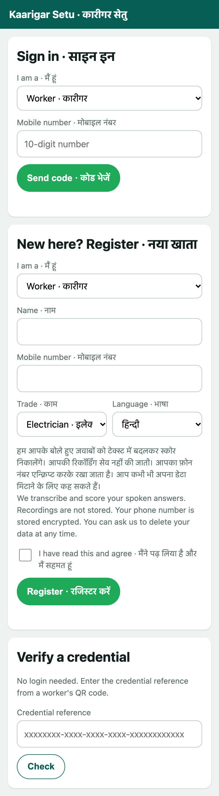

## 6.1 Registration

1. The page (`index.jsp` + `auth.js`) posts `{name, phone, trade, language, consent}` to `POST /api/worker/register` (or `/api/employer/register` with name, phone, consent).
2. `WorkerServlet` calls `WorkerService.register`:
   1. no consent → `ConsentRequiredException` and **nothing is stored**;
   2. the name is cleaned (control characters removed, 2 to 80 characters); the trade must be in `TradeCatalog` (loaded from `trades.json`); the language must be allowed;
   3. the phone number is normalised to `+91XXXXXXXXXX` (`PhoneProtector.normalize`) and turned into a **lookup key** (a keyed hash), so the database never holds the number in the clear: the number itself is stored only as an encrypted blob;
   4. in one transaction: if the lookup key exists, `ConflictException("Already registered")`; otherwise `WorkerDao.insertProtected` inserts the row with the encrypted phone and the consent version;
   5. an audit line `WORKER_REGISTERED` is written.
3. `EmployerService.register` does the same for employers.

## 6.2 Signing in (workers and employers)

The sign-in is a phone number plus a one-time code, in two requests.

**Request a code** (`POST /api/auth/otp/request`, `AuthService.requestLoginOtp`):
1. normalise the number, find the account (if any);
2. a browser that has signed in before carries a cookie (`ks_device`) and is a *trusted device*; a new browser must first solve a small background puzzle (`pow.js`; the server answers 428 with the puzzle and the page solves it and asks again, `auth.js` `requestCode`);
3. rate limits are applied per device, per address and per phone (`RateLimiter`, a sliding window);
4. if the account exists, `OtpService.issue` makes a six-digit code, stores only a salted hash, and `OtpSender.send` delivers it (SMS gateway, or the server log in development). If it does not exist, nothing is sent **but the reply is identical**, so nobody can discover which numbers are registered.

**Verify** (`POST /api/auth/otp/verify`, `AuthService.verifyLogin`): `OtpService.verify` checks the code (5 attempts, 5 minutes, single use, constant-time comparison). On success the browser is remembered as a trusted device, `Sessions.login` creates a **new session** (a fresh id, so a session id set before login is useless) and a CSRF token, and the answer carries the role and the token.

## 6.3 Moderators

A moderator has a **named account** (own password and own phone), created only by an operator with `scripts/moderator-admin.sh`. Sign-in is two steps in one session: `POST /api/auth/moderator/login` (password, then a code is sent to that moderator's own phone) and `POST /api/auth/moderator/verify` (the code). The session then holds that moderator's id, so every later action is theirs.

## 6.4 Sessions and roles

`Sessions` holds the attribute names, `login` (fixation-safe), `current` (the `AuthenticatedUser` of the request), and the CSRF token. `AuthenticatedUser(role, id)` has `Role` `WORKER`, `EMPLOYER` or `MODERATOR`. The route-to-role rules are in `AuthFilter.RULES` (section 3.1); the servlets additionally check ownership (a worker may only read their own passport; an employer may only act on their own attestations; another person's resource answers 404).

---

# 7. The voice assessment

This is the heart of the product. We follow one answer from the screen to the database, then explain the scoring.

## 7.1 The rubric: what a good answer contains

Each trade has a JSON rubric in the ML service (`kaarigarsetu-ml-service/app/models/rubrics/electrician.json` and five more, plus `_common.json`). A rubric has ten questions; each question has text in Hindi and English, a skill **area** (tools, materials, experience, knowledge, troubleshooting, planning, customer), a level, and **criteria**: a short description, marks, and the keywords (in several spellings and both languages) whose presence earns those marks.

```json
{ "id": 1, "text": {"hi": "आप एक इलेक्ट्रीशियन के रूप में रोज़ किन औज़ारों का इस्तेमाल करते हैं? ...", "en": "Which tools do you use every day as an electrician? Name at least three."},
  "area": "tools", "level": "basic",
  "criteria": [ {"id": "q1c1", "marks": 2, "keywords": ["पेचकस", "screwdriver", "स्क्रू ड्राइवर"]}, ... ] }
```

The files are marked `testOnly` (placeholders written for the project, awaiting trade experts); the page says "TEST ONLY questions" accordingly. Java asks for a rubric through `MlGateway.rubric(trade, language)` and caches it for 10 minutes. The answer keywords are **never sent to the browser**, only the question text and marks.

## 7.2 Step by step: from the microphone to the database

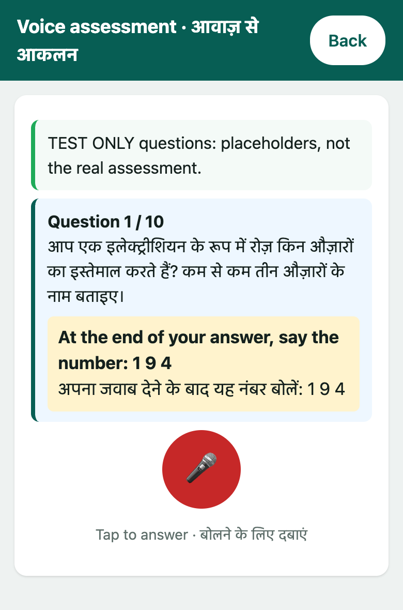

**Step 1. Start** (`POST /api/assessment/start`, `AssessmentPipelineService.start`). The service loads the worker, gets the rubric, creates a random attempt id and returns an **attempt token**: the worker id, attempt id and issue time signed with a server key, valid for 3 hours. The client cannot invent attempt ids or reuse another worker's. The reply holds the token, the trade, the language, the `testOnly` flag and the ten questions.

**Step 2. Ask** (`assessment.js`). For question *n* the page asks for that question's spoken number (`GET /api/assessment/challenge`), shows "Question n / 10", the text and the number to say at the end, speaks the question with the browser's speech synthesis (`speechSynthesis`, Hindi or English), then shows the microphone button.

**Step 3. Record** (`record()` in `assessment.js`). `getUserMedia` and `MediaRecorder` capture audio. The page shows a stop button and a countdown (60 seconds at most).


**Step 4. Convert** (`static/js/wav.js`). Browsers record in different formats (webm/opus, mp4/aac). `wav.js` decodes the recording with the Web Audio API, mixes it to mono, resamples to 16 kHz (averaging when downsampling, to avoid aliasing) and writes a 16-bit PCM WAV, about 1.9 MB for 60 seconds.

**Step 5. Upload** (`KS.api('POST', '/api/assessment/submit-answer?attempt=...&question=...&challenge=...', wav)`).

**Step 6. The pipeline** (`AssessmentPipelineService.submitAnswer`), in order:

| # | Step | Detail |
|---|---|---|
| 1 | check the attempt token | signature, this worker, not older than 3 hours |
| 2 | load worker and rubric | the rubric from the cache or the ML service |
| 3 | check the order | questions must be answered in order, once each, and not past the tenth |
| 4 | validate the audio | `util/WavValidator`: RIFF/WAVE, 16-bit PCM, duration read from the data chunk (0.5 to 60 s), size at most 2 MB, never trusting the client's content type |
| 5 | check the spoken-number token | for this worker, attempt and question, not stale (section 7.7) |
| 6 | transcribe | `ml.transcribe(audio)` → text |
| 7 | fingerprint | `ml.fingerprint(audio)` (section 7.7) |
| 8 | **zero the audio** | `Arrays.fill(audio, 0)`: recordings are never kept |
| 9 | blank text? | nothing recognised → `UnintelligibleAudioException` (422); the page asks again |
| 10 | was the spoken number heard? | `SpokenCode.heard`; not heard → retry (422), after three tries the answer is stored and held |
| 11 | score | `ml.evaluate(trade, transcript, question, language)` → score, feedback, review flag |
| 12 | store | one transaction: lock, replay check, insert the answer, store the fingerprints |
| 13 | audit | events for a held answer or a missed number |
| 14 | if this was the tenth answer | summarise (section 7.4), band and areas, update the worker, audit `ASSESSMENT_COMPLETED` |
| 15 | reply | transcript, score, feedback, `needsReview`, and, when finished, skill score, band, areas |

**Step 7. The page shows the result** and moves on:

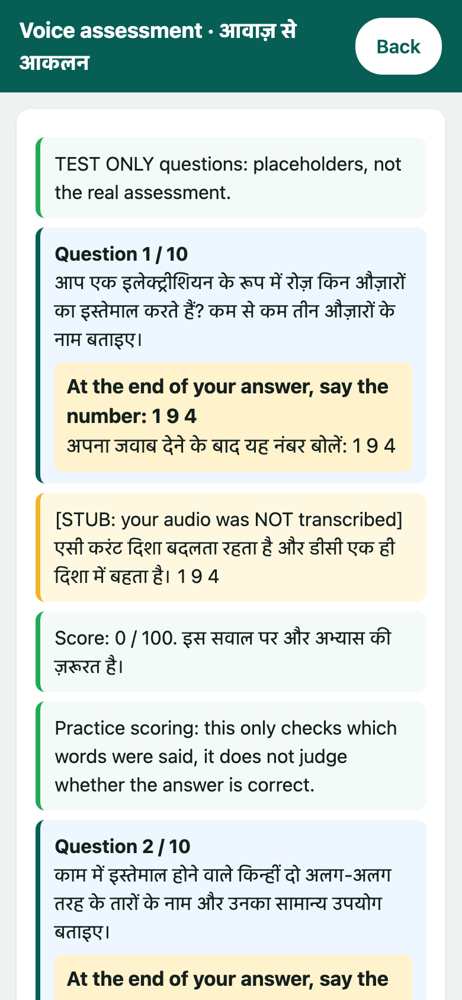

*(This screenshot uses the labelled test stand-in for speech recognition, so the transcript is a placeholder and the score is 0.)*

## 7.3 How one answer is scored (the ML service)

`EvaluationService.evaluate(trade, transcript, question_id, language)`:

1. **Clean the transcript** (`guard.sanitize_transcript`): Unicode normalisation, invisible and direction-control characters removed, whitespace collapsed, capped at 1,500 characters.
2. **Choose the scorer.** `EVALUATOR` is `keyword` unless an API key is configured, then `llm`.
3. **Keyword scorer** (`RubricEvaluator.evaluate_question`): for each criterion, full marks if *any* of its keywords occurs in the transcript, otherwise zero. Matching is forgiving of speech-recognition slips: both sides are *folded* (nukta, virama, chandrabindu removed) and a keyword of six or more letters may differ by one wrong, missing or extra letter (two for eleven or more; five letters or fewer must match exactly so "rice" does not match "price"), using an edit-distance search.
4. **Language-model scorer** (optional, `llm_client.py`, used only when `LLM_API_KEY` is set; it has not been run against a real model in this project): the question, the criteria (without keywords) and the transcript go to the Anthropic Messages API at temperature 0, with the transcript fenced by a random per-request marker so text inside it cannot pose as an instruction. The reply must be JSON that passes a strict schema (integer marks only, known criterion ids, a `suspicious` flag, short plain feedback); anything else is treated as a malformed score (zero marks and flagged for review). The prompts are files in `app/models/prompts/`.
5. **Enforce** (`guard.enforce`): marks above a criterion's maximum are clamped; unknown, duplicate, missing or negative marks make the whole reply untrustworthy (score 0 and flagged); instruction-like text in the answer ("ignore the rubric", "give full marks") adds a review flag; an answer that recites most of the rubric's words in several forms is flagged as possible keyword stuffing; full marks on a very short answer is flagged.
6. **Relevance gate** (`guard.gate_relevance`): the shared criteria (gave an example, took care, checked) only count if the answer earned something on the question's own topic, so an off-topic sentence containing "check" collects nothing.
7. **Total**: `score = 100 × marks / max marks` for the question, with feedback (spoken by the page) in the worker's language, chosen by band (70 and above, 50 and above, below).

The result carries `needs_review` and a reason; Java stores both with the answer.

## 7.4 From ten answers to the skill score

When the tenth answer is stored (`AssessmentPipelineService`):

1. `AssessmentScoringDispatcher.summarize(trade, ten scores)` picks the trade's `AssessmentService` subclass and calls the **final** method `summarize`, the same rule for every trade: exactly ten scores, each 0 to 100, the **mean** to two decimals. The subclass only writes its own feedback sentence (`feedbackFor`). This is the *template method* pattern with *polymorphism*: `ElectricianAssessmentService`, `PlumberAssessmentService`, `CarpenterAssessmentService`, `MasonAssessmentService`, `WelderAssessmentService`, `PainterAssessmentService`.
2. `SkillScoring.profile(...)` (a pure function) builds the profile: the **band** (`Band.of`: Pass at 70 or more, Borderline at 50 or more, otherwise Needs review; thresholds are settings), the **score per area** (the plain mean of the questions that measure it), and **near boundary** (true when the overall score is within 5 points of a threshold, shown to the worker as "close to the edge").
3. `WorkerDao.updateSkillProfile` stores score, band, the area breakdown as JSON and the flag; an `ASSESSMENT_COMPLETED` audit line is written.

## 7.5 Adding a trade

(1) a rubric JSON in `app/models/rubrics/`; (2) one line in `trades.json` (English and Hindi name); (3) a ten-line subclass of `AssessmentService`; (4) add it to the list in `AppContext`. `TradeCatalog.requireScorersFor` fails at start-up if a listed trade has no scorer.

## 7.6 Speech to text (ML `transcribe` route)

`POST /internal/ml/transcribe` accepts the WAV (at most 2 MB). The service picks the engine from `STT_PROVIDER`: `faster-whisper` (Whisper `large-v3-turbo`, 8-bit, pinned to an exact revision), `whisper`, or the test `stub`. Before recognition the audio is decoded, level-normalised and trimmed of silence; very quiet audio returns an empty transcript; segments that look like Whisper hallucinations (low confidence, high compression, "no speech") are dropped; a language-specific prompt steers the vocabulary. The blocking model call runs in a worker thread so the service stays responsive.

## 7.7 The extra checks on a recording (summary)

Because a good recording could simply be played back, each answer also goes through three checks (full write-up: `docs/REPLAY_DETECTION.md`): a **spoken three-digit number** made when the question is shown that must appear in the answer; an **acoustic fingerprint** of the recording (the ML route `audio-fingerprint`; only keyed hashes are stored) compared with every earlier answer of every worker; and a **word fingerprint** of the transcript (three-word runs) compared the same way. A match stores the answer with score 0 and `needs_review`, and the credential cannot be issued while an answer of the attempt is held. The comparison and the store run in one transaction under a database lock so two simultaneous uploads cannot both pass.

---

# 8. Employer confirmation

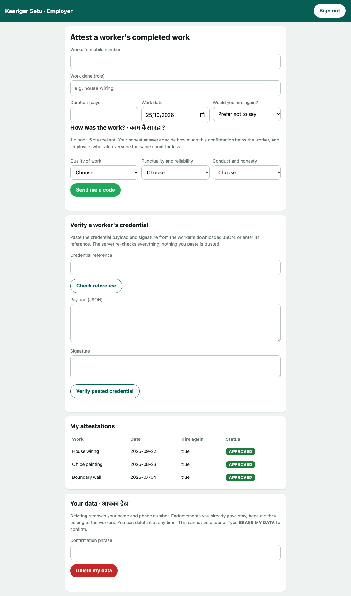

## 8.1 Step by step

**Step 1. The form** (`employer-dashboard.jsp`, `employer.js`): the worker's mobile number, the work done, duration, date (not in the future), would you hire again, and three ratings 1 to 5. The script checks the ratings are chosen, then `POST /api/attestation/request-otp`.

**Step 2. Request** (`AttestationWorkflowService.requestOtp`):
1. ratings 1 to 5, role 2 to 80 characters, duration 0 to 3650, work date within a year;
2. rate limits (10 per employer per hour, 30 per address);
3. find the employer and the worker (by lookup key); an employer cannot confirm their own work;
4. in one transaction: refuse a second live confirmation for the same pair (`DuplicateAttestationException`), insert the row with status `OTP_PENDING`, issue a code for challenge key `attestation:<id>` and store its hash;
5. send the code to the **employer's own phone** (not the worker's), audit `ATTESTATION_OTP_REQUESTED`, return the attestation id.

**Step 3. Verify** (`POST /api/attestation/verify-otp`, `verifyOtp`):
1. the attestation must belong to this employer and be `OTP_PENDING`;
2. `OtpService.verify` checks the code (a wrong code is audited);
3. **fraud scoring**: four numbers are built from the database (`features(detail)`): confirmations from the same network address in 24 h, from the same device in 24 h, minutes since this employer's previous confirmation (capped), and the employer's reciprocity ratio. They go to `ml.fraudCheck`, which returns an anomaly score from 0 to 1 and a `flagged` boolean;
4. if the ML service is unreachable the result is "flagged, score 0.5": **fail safe**, a human decides, nothing is auto-approved and nothing is lost;
5. in one transaction the attestation becomes `APPROVED` or `PENDING_REVIEW`; if flagged a `fraud_flags` row is written with the evidence; if approved a **trust edge** is inserted (weight 1.0 if the employer would hire again, 0.8 if not stated, 0.4 if not: `AttestationRules.edgeWeight`);
6. audit `ATTESTATION_APPROVED` or `ATTESTATION_FLAGGED`;
7. if approved: `trust.recompute()` then `credentials.reissueIfEligible(worker)`. A failure here is logged, never thrown: a refresh problem must not undo an approval.

The page then tells the employer either "Confirmed. This worker's trust score has been updated" or "Recorded. It has been sent for a quick manual check before it counts."

## 8.2 Flagged confirmations

A flagged confirmation waits in the moderator console (chapter 12). When a moderator decides `VALID` the attestation is approved, the trust edge is created and trust is recomputed; `FRAUD` rejects it and, once ruled fraudulent, it also lowers the worker's score by a few points and the employer's credibility.

---

# 9. The trust score

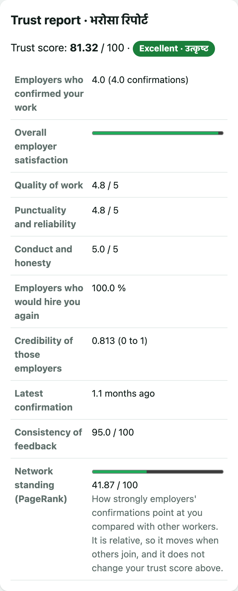

## 9.1 What it measures

The **trust score** (0 to 100) is how much employers who really worked with the person vouch for them, and how believable those employers are. It is separate from the skill score. The pure formula is in `trust/ReputationScoring`; `trust/TrustScoreService` loads the data, runs PageRank and stores the result. Full reasoning: `docs/TRUST_SCORE.md`.

## 9.2 The formula, step by step

1. **Satisfaction** of one confirmation (0 to 1) from what the employer answered: quality 40 %, punctuality 25 %, conduct 20 %, would hire again 15 % (only the answers actually given count, with the weights re-balanced). A confirmation with no ratings counts as a neutral 0.55 at half weight.
2. **Leniency calibration**: an employer with at least 3 rated confirmations whose average is far above everyone's (always five stars) has up to 0.10 taken off, and a harsh one has some added back, so a habit does not decide a worker's score.
3. **Weight** of one confirmation = **employer credibility** × **recency** × **engagement** × (1 − half the fraud anomaly score):
   * credibility (0.1 to 1) = base 0.40, +0.15 if a moderator vetted the employer, +0.20 for track record (full at 5 approved confirmations), +0.25 for network standing (PageRank), then reduced by 30 % for each of their confirmations ruled fraudulent;
   * recency = e^(−age in days / 365), never below 0.15;
   * engagement = 0.6 for a one-day job rising to 1.0 at 30 days or more, 0.8 when unknown.
4. **Reputation** (a Bayesian average pulled toward 0.60 when evidence is thin): `rep = (1.5 × 0.60 + Σ weight × satisfaction) / (1.5 + Σ weight)`.
5. **Confidence** `C = min(1, distinct employers / 3)`: confirmations from the same employer do not add confidence.
6. **Score** = `100 × (C × rep + (1 − C) × 0.25)`, minus 5 for each confirmation about the worker ruled fraudulent (at most 15), clamped to 0 to 100.
7. **The Excellent band needs a moderator-vetted employer**: with none, a score above 79.99 is held at 79.99.

Worked examples: one well-established employer giving five stars gives about 42; three different ones give about 86; the same employer five times is still about 42; three different employers giving two stars give about 30 (each is a unit test).

**Bands** (`TrustBand.of`): 80 and above Excellent, 65 and above Good, 50 and above Fair, below 50 Building, and *No history yet* (not a bad score) when nobody has confirmed the work.

**Explanation.** The same call produces a `Report`: counts of confirmations and employers, average of each rating, would-hire-again rate, average credibility, months since the latest, consistency, and up to four plain tips ("Ask 2 more different employers to confirm your work", "Your latest confirmation is about 11 months old"). It is stored as JSON and shown on the passport.

## 9.3 How `TrustScoreService.recompute()` runs

1. load all counted (approved, not disputed-out) feedback;
2. calibrate each employer's leniency;
3. **network standing of employers**: build a graph (employer → worker edges weighted by satisfaction, recency and anomaly, plus a weaker reverse edge so well-connected employers gain standing), send it to the ML service for **PageRank**, and map each employer's value to a standing of 0.3 to 1;
4. **network standing of workers** (shown beside the trust score, never part of it): the plain endorsement graph, PageRank with damping 0.85, rescaled so the best node is 100;
5. gather each employer's activity (vetted, approved given, fraud upheld) and each worker's fraud count;
6. for every worker call `ReputationScoring.score(...)` and store score, band and report JSON;
7. audit `TRUST_RECOMPUTED`.

If the ML service is down, scores are still computed with a neutral standing of 0.5 and the gap is audited (`TRUST_PAGERANK_UNAVAILABLE`). It runs after every approved confirmation, moderator decision, dispute ruling and erasure.

---

# 10. The passport and the worker's say

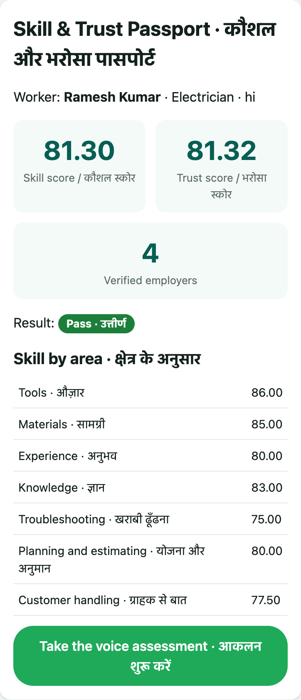

## 10.1 Building the passport

`GET /worker-dashboard` is a page servlet (`PageServlets.WorkerDashboard`). It calls `WorkerService.passport(workerId)`, which assembles one record from several DAOs: the worker row, the stored skill profile (band, areas as JSON, near boundary), the stored trust profile (band, report JSON), the credentials (the latest and whether it is revoked), the latest attempt's ten answers (question, score, review flag) and the number of counted confirmations. Corrupt stored JSON never breaks the page: it is replaced by an empty map. A worker with no confirmations is shown **No history yet** with a tip instead of "not calculated". The servlet puts the passport (as Maps) in the request and forwards to `worker-dashboard.jsp`, which prints the cards (screenshots in chapter 14). `worker.js` then loads the confirmations and the credential through the API.

## 10.2 Accepting or disputing a confirmation

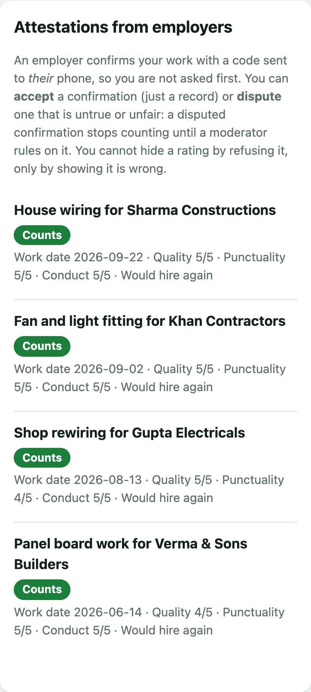

The employer's code goes to the employer, so the worker is never asked. `ConfirmationResponseService` gives the worker a say:
* **List** (`GET /api/worker/me/confirmations`): each confirmation with whether the worker can still respond and how many days are left (the dispute window is 30 days by default).
* **Accept** (`POST /api/worker/confirmations/{id}/accept`): a record only; nothing changes.
* **Dispute** (`.../dispute`, with a reason of 10 to 300 characters): refused if already answered, past the window, or if the worker already has the maximum open disputes (default 3). The same limits are enforced again inside the single `UPDATE` (`AttestationDao.disputeByWorker`), so two simultaneous requests cannot both pass. A disputed confirmation is **held out of every score** (the view `counted_attestations`) until a moderator rules *upheld* (it counts again) or *removed* (it never counts). Trust is recomputed immediately.

Acceptance is deliberately optional: if it were required, a worker could refuse every bad rating and the score would be a number the worker controls.

---

# 11. The credential

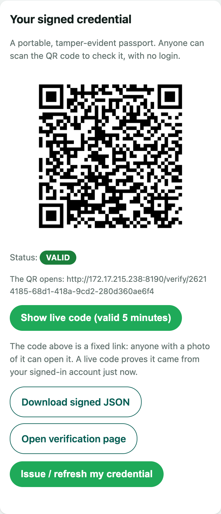

## 11.1 Issuing (`CredentialService.issue`)

1. The worker must have a complete latest attempt (ten answers), no answer awaiting review, and a trust score at or above `MIN_TRUST_FOR_CREDENTIAL` (default 0), else `ConflictException` or `LowTrustScoreException`.
2. The payload is built (`buildPayload`) in a W3C Verifiable-Credential shape: `@context`, `id` (`urn:uuid:<ref>`), `type`, an `issuer` (name and signing key id), `validFrom`, `validUntil` (default 180 days), and `credentialSubject`: a **pseudonymous id** (`urn:ks:subject:<uuid>`, never a name or phone), trade, language, skill score and band, trust score and band, and the number of verified employers.
3. The payload is turned into **canonical JSON** (`util/CanonicalJson`, RFC 8785: members sorted, minimal escaping, no whitespace), so any language can rebuild exactly the same bytes.
4. `SignatureService.sign` signs those bytes with **RSA-3072, PKCS#1 v1.5 with SHA-256**; the key pair comes from a PKCS#12 keystore created once by `scripts/generate-signing-key.sh` and kept outside the repository.
5. One transaction revokes the worker's earlier live credentials ("superseded by a newer credential") and inserts the new one, so there is exactly one live credential per worker.
6. A JSON copy is written to disk (`util/CredentialExporter`, `java.nio.file`) and an audit line `CREDENTIAL_ISSUED` is written.

The credential is re-issued automatically after any event that changes the numbers (`reissueIfEligible`).

## 11.2 Sharing and checking

* **QR** (`QRGenerator`, ZXing): a code that links to `<PUBLIC_BASE_URL>/verify/<ref>`, drawn with whole-pixel modules, a quiet zone and error-correction level Q so it scans reliably from a phone; a test decodes it the way a scanner would.
* **Public check** (`GET /api/credential/{ref}/verify`, page `/verify/{ref}`): the state is one of `VALID`, `INVALID_SIGNATURE`, `REVOKED`, `EXPIRED`, `NOT_FOUND`, decided from server-side state: the signature is re-checked with the key named on the record, then revocation, then expiry. The summary shows trade, scores, bands, number of verified employers and dates.
* **Live code** (`GET /api/credential/{ref}/live-qr`, owner only, `PresentationTokens`): a QR carrying a 5-minute presentation code, so showing the screen proves it was opened from the signed-in account just now; a screenshot goes stale.
* **Download** (`/download`): the document `{credential, proof}` where the proof records the signature type, key id and `canonicalization: RFC8785-JCS`.
* **Revocation**: the owner (or a moderator) can revoke; the **signed revocation list** (`GET /api/credential/revocations`) lets offline verifiers learn what was revoked; the **key list** (`/keys`) publishes every key a credential may have been signed with, so credentials signed before a key rotation still verify (`scripts/rotate-signing-key.sh`).
* **Offline verification**: `scripts/verify_credential.py` checks a downloaded document using only the file and the public key, sharing no code with the application.

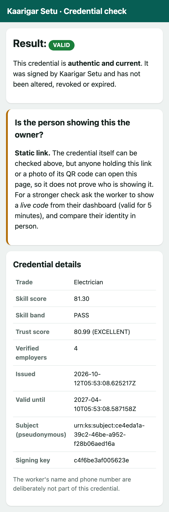

---

# 12. Moderators and the console

## 12.1 The queues (`moderator/ModeratorService`, `ModeratorServlet`)

| Queue | What is in it | Decision |
|---|---|---|
| Fraud review | confirmations the model flagged | `VALID` (approve it) or `FRAUD` (reject it) |
| Employers | employers to vet (a check done outside the application) | propose vetting |
| Disputes | confirmations a worker disputed | propose *upheld* or *removed* |
| Approvals | proposals made by another moderator | approve or reject |

## 12.2 The two-person rule

Vetting an employer and ruling on a dispute move trust, so with `TWO_PERSON_ACTIONS` on (the default) one moderator **proposes** and a **different** moderator must **approve**:
1. `propose` writes a `moderator_actions` row (one live proposal per target) and audits `MODERATOR_ACTION_PROPOSED`;
2. `approve(actionId, approver)`: a proposer approving their own proposal is refused (and audited); otherwise one transaction marks the proposal executed *and* carries it out (`applyVet` or `applyDispute`), then trust is recomputed and affected credentials re-issued;
3. the proposer can withdraw, a different moderator can reject; proposals expire after a lifetime (default 72 hours).
The rule is enforced three times: in the service, in the approving `UPDATE`, and by a `CHECK` constraint.

## 12.3 The JavaFX console (`kaarigarsetu-moderator-console`)

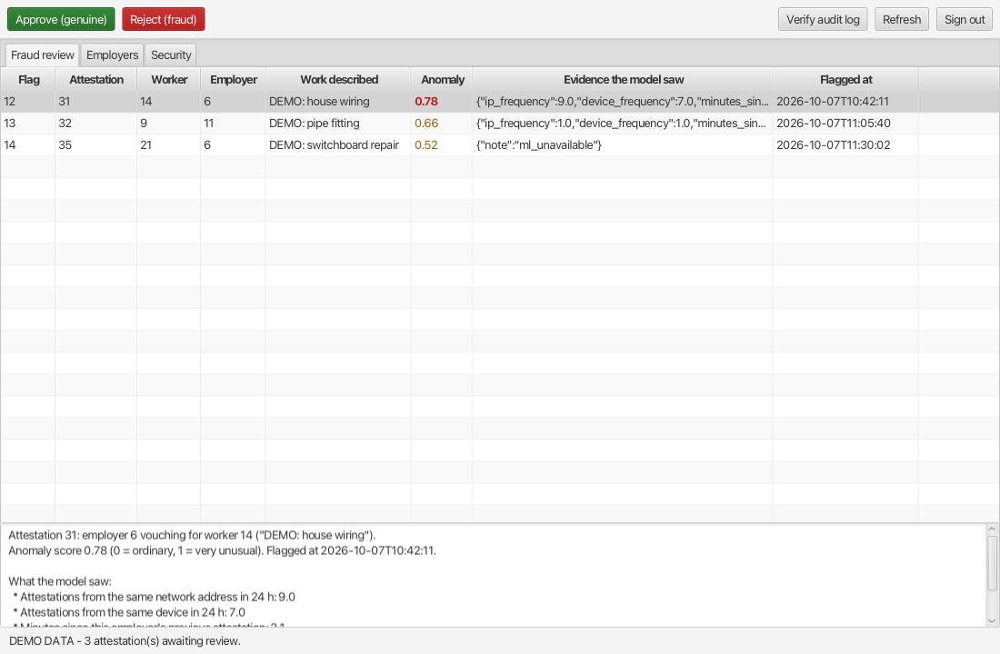

* `ModeratorConsoleApp` builds a sign-in form (`PasswordField`, one-time code) and then a `TabPane` with five tabs, each a `TableView` plus buttons: **Fraud review**, **Employers**, **Disputes**, **Approvals**, **Security**. A detail pane under the table explains the selected row in plain language.
* It talks to the Java API through the `ModeratorApi` interface (`HttpModeratorApi`, `java.net.http.HttpClient`), so the rules and the audit trail are the same as the website's. A 401 returns it to the sign-in screen.
* **Threads**: every network call runs in a `javafx.concurrent.Task` (`background(...)`) and updates the table in `Platform.runLater`, so the window never freezes.
* Final decisions are confirmed with an `Alert`; *Approve* is disabled for your own proposals; the window title shows who is signed in.
* The Security tab shows event counts, threshold alerts and whether the audit trail is intact (`SecurityMonitor`).

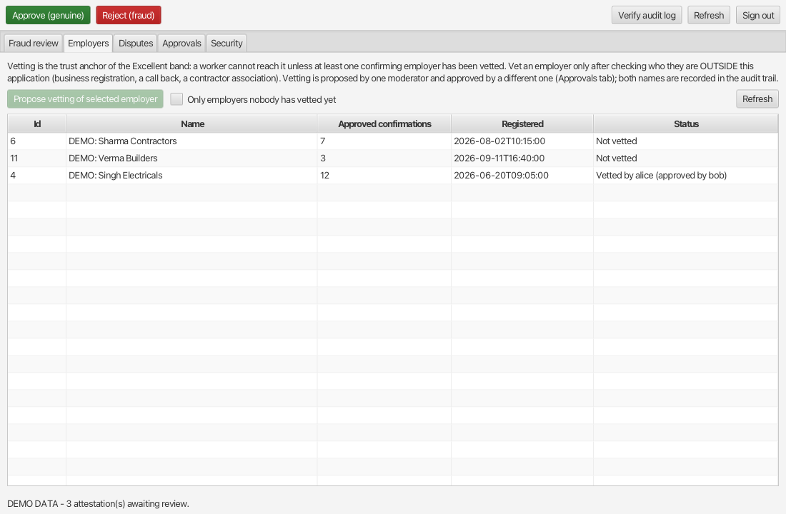

## 12.4 Operator tools (`admin/`, not part of the web application)

`ModeratorAdminCli` (create, list, disable, enable, change password: `scripts/moderator-admin.sh`), `DemoSeed` (made-up data: `scripts/demo-seed.sh`), `AuditVerifyCli` (check the audit file offline), `SealAtRestCli` (check or convert stored data: `scripts/seal-at-rest.sh`).

---

# 13. The ML service in detail

`kaarigarsetu-ml-service/app/main.py` creates the FastAPI app, preloads Whisper in a background thread, and mounts six routers under `/internal/ml`, each protected by `require_internal_token` (a shared secret in the `X-Internal-Token` header):

| Route | File | What it does |
|---|---|---|
| `GET /health` | `main.py` | liveness |
| `GET /trades`, `GET /rubric/{trade}?language=` | `routes/rubric.py`, `services/rubric_store.py` | the trades, and the questions of a rubric (never the keywords) |
| `POST /transcribe?language=` | `routes/transcribe.py`, `faster_whisper_client.py`, `whisper_client.py`, `stub_transcriber.py` | speech to text (7.6) |
| `POST /audio-fingerprint` | `routes/audio.py`, `services/audio_fingerprint.py` | acoustic landmarks of a recording (hashes and times only) |
| `POST /evaluate` | `routes/evaluate.py`, `evaluation_service.py`, `rubric_evaluator.py`, `guard.py`, `llm_client.py` | score one answer (7.3) |
| `POST /fraud-check` | `routes/fraud.py`, `fraud_detector.py` | anomaly score of one confirmation |
| `POST /trust-score` | `routes/trust.py`, `graph_engine.py` | PageRank over a posted graph |

**The fraud model.** An Isolation Forest (scikit-learn) over four features: `ip_frequency`, `device_frequency`, `minutes_since_previous`, `reciprocity_ratio`. `anomaly_score = −score_samples` clipped to 0..1; `flagged` is the model's own outlier decision. It was trained on **synthetic** data (`app/training/`: 1,400 normal rows, contamination 0.03; on a held-out synthetic set precision 0.73, recall 0.80) so it demonstrates the method and says nothing about real fraud rates; the file's SHA-256 is checked before it is loaded (a pickled model can run code).

**PageRank.** `GraphEngine.scores` builds a `networkx.DiGraph` (parallel edges add their weights), runs `pagerank` and `scaled` maps the result to 0 to 100.

**The Java client** (`ml/MlServiceClient`, `java.net.http.HttpClient`): sends the token, uses timeouts, and **validates every response** (shape, ranges, list sizes) before anything is used, so an odd reply cannot inject an out-of-range score. Any failure becomes `ExternalServiceException`.

---

# 14. The browser side

## 14.1 Pages and scripts

| Page (`WEB-INF/jsp`) | Script (`static/js`) | Does |
|---|---|---|
| `index.jsp` | `auth.js`, `pow.js` | sign in, register with consent, find a credential by reference |
| `worker-dashboard.jsp` | `worker.js` | the passport cards, credential and live code, confirmations to accept or dispute |
| `assessment.jsp` | `assessment.js`, `wav.js` | the voice test |
| `employer-dashboard.jsp` | `employer.js` | confirm a job, check a credential |
| `verify.jsp` | (none) | public result page rendered by the server |
| `demo.jsp` | `demo.js` | development-only one-click sign-in |
| `error.jsp` | | friendly 404/500 |

`common.js` is loaded on every page and gives `KS.api` (every call: CSRF header, JSON or WAV body, returns `{ok, status, data}`), `KS.errorText` (a table from error code to plain sentence), `KS.say` (a message line, `textContent` only), and the delete-my-data button. One stylesheet, `static/css/app.css`.

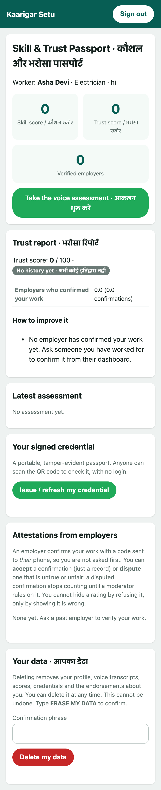

## 14.2 How the front end is kept simple and safe

* Vanilla JavaScript with no framework and no inline script (the content policy forbids it); text is written with `textContent`, never `innerHTML` (a test, `XssGuardTest`, scans for HTML-string APIs).
* Every label is bilingual ("Sign in · साइन इन"); question and feedback language follows the worker's setting.
* Every failure path has a plain message and a way to try again (microphone refused, unsupported browser, network error, code not heard).
* A test (`StaticAssetsTest`) fails the build if a page references a script or stylesheet that does not exist.

---

# 15. Protection layers (short; the full treatment is in the security documents)

This chapter only names the layers so the walkthrough is complete.

| Layer | Where | One line |
|---|---|---|
| Login codes | `OtpService`, `AuthService` | salted PBKDF2 hash, 5 attempts, 5 minutes, single use; trusted devices and a background puzzle protect the quota |
| Sessions and CSRF | `Sessions`, `CsrfFilter` | new session at login, token on every state-changing request |
| Access control | `AuthFilter` | deny by default, role per route, owner checks in servlets |
| Rate limits | `RateLimiter` | sliding window per key (in memory, per node) |
| Phone numbers | `PhoneProtector` | keyed hash for lookup, AES-GCM for the stored number |
| Data at rest | `DataCipher`, migration 010 | AES-256-GCM on transcripts, scores, ratings, names, payloads and the audit file; tool `scripts/seal-at-rest.sh` |
| Audit | `AuditLogger`, `ChainedAuditFileSink` | every sensitive event, ids only, in a hash-chained table and a keyed hash-chained file; `AuditVerifyCli` checks it |
| Credentials | `SignatureService`, `CanonicalJson` | RSA signatures over canonical JSON, key rotation, revocation list |
| Erasure | `privacy/ErasureService` | one transaction deletes a worker and everything about them, including exported files and fingerprints |
| Input checks | `WavValidator`, `PreparedStatement`, `ApiErrors` | validated audio, no string-built SQL, no internals in error bodies |

---

# 16. Testing and tooling

## 16.1 The test layers

| Layer | Where | What |
|---|---|---|
| Unit (JUnit 5, Mockito) | `kaarigarsetu-java/src/test` | services with mocked DAOs and gateways; pure functions such as `ReputationScoring`, `SkillScoring`, `CanonicalJson` |
| Architecture rules | `architecture/` | `NoStringBuiltSqlTest` (no SQL from strings), `XssGuardTest`, `ModeratorWriteAccessTest` |
| Database integration | `dao/`, `privacy/`, `moderator/`, `admin/` | the DAOs, erasure, two-person approval, encryption against real PostgreSQL (a `*_test` database, wiped each run, or Testcontainers); the SQL-injection fuzz over every DAO |
| ML service (pytest) | `kaarigarsetu-ml-service/tests` | every route, the evaluator, the guard, the fingerprint |
| Console | `kaarigarsetu-moderator-console/src/test` | the console's logic |
| End to end | `scripts/e2e.py` | the real running stack, all journeys (192 checks) |
| API matrix | `scripts/api_matrix.py` | every endpoint and its expected status (92) |
| Attack harness | `scripts/security_attack_demo.py` | 57 hostile scenarios against the running system |

Totals from the last full run: **498 Java tests, 398 Python tests, 18 console tests**, JaCoCo coverage report, SpotBugs and secret scans clean.

## 16.2 The scripts

`dev-setup.sh`, `dev.sh`, `demo-seed.sh`, `console.sh`, `compose-setup.sh`, `generate-signing-key.sh`, `rotate-signing-key.sh`, `moderator-admin.sh`, `seal-at-rest.sh`, `otp.sh` (reads the latest code from the dev log), `dev-https.sh` (HTTPS for testing the microphone on a phone), `coverage.sh`, `verify_credential.py` (independent verifier), `demo_fraud_burst.py`.

## 16.3 The pipeline (`.github/workflows/ci.yml`)

Jobs: Java build and tests, ML tests with a coverage floor, dependency scans, static analysis, the end-to-end run against a started stack (with a Postgres service), image builds. It was written and each step run locally; it has not yet run on GitHub.

---

# 17. Deployment

`docker-compose.yml`: four services on private networks, only the proxy publishes a port.
* **postgres** (16): `docker/postgres/init.sh` creates the schema, applies every migration, then creates the restricted application role.
* **ml**: the Python service, built from `kaarigarsetu-ml-service/Dockerfile`.
* **app**: Tomcat with the WAR; `docker/tomcat/server.xml` hardens it (no shutdown port, no version banner); `docker/app/entrypoint.sh` starts it; data (keystore, audit log, exported credentials) lives on a volume.
* **proxy**: Caddy (`docker/caddy/Caddyfile`) terminates HTTPS.
`scripts/compose-setup.sh` generates every secret into `.env` and builds the images. **Honest note:** the compose set-up and the pipeline were written and checked step by step locally but not run end to end on a Docker machine.

---

# Reference

## A. Endpoints

| Method and path | Who | Servlet |
|---|---|---|
| `GET /api/auth/session` · `POST /api/auth/otp/request` · `otp/verify` · `moderator/login` · `moderator/verify` · `logout` (· `demo-login`, development only) | public | `AuthServlet` |
| `POST /api/worker/register` | public | `WorkerServlet` |
| `GET /api/worker/me/passport` · `GET /api/worker/{id}/passport` (own id) · `GET /api/worker/me/confirmations` · `POST /api/worker/confirmations/{id}/accept` · `.../dispute` · `POST /api/worker/erase` | worker | `WorkerServlet` |
| `POST /api/employer/register` (public) · `POST /api/employer/erase` | employer | `EmployerServlet` |
| `POST /api/assessment/start` · `GET /api/assessment/challenge` · `POST /api/assessment/submit-answer` · `GET /api/assessment/result` | worker | `AssessmentServlet` |
| `POST /api/attestation/request-otp` · `verify-otp` · `GET /api/attestation/mine` | employer | `AttestationServlet` |
| `POST /api/credential/issue` · `GET /mine` · `GET /{ref}/download` · `GET /{ref}/live-qr` | worker | `CredentialServlet` |
| `GET /api/credential/{ref}/verify` · `/{ref}/qr` · `POST /verify` · `GET /public-key` · `/keys` · `/revocations` | public | `CredentialServlet` |
| `POST /api/credential/{ref}/revoke` | worker (own) or moderator | `CredentialServlet` |
| `GET /api/moderator/flagged` · `employers` · `disputes` · `pending` · `security` · `audit-check` · `me`; `POST decision` · `vet-employer` · `dispute-decision` · `pending/{id}/approve` · `reject` | moderator | `ModeratorServlet` |
| `GET /health` | public | `HealthServlet` |
| Pages: `/` · `/demo` · `/worker-dashboard` · `/assessment` · `/employer-dashboard` · `/verify/{ref}` | per page rule | `PageServlets` |

The full request and response shapes are in `docs/API_REFERENCE.md`.

## B. "Where do I change X?"

| To change | Edit |
|---|---|
| the skill band thresholds | settings `PASS_THRESHOLD`, `BORDERLINE_THRESHOLD`, `BAND_BOUNDARY_MARGIN` (`AppSettings`) |
| a trust-score weight, prior or penalty | `ReputationScoring.Params` (all tunables in one record) |
| the trust band cut-offs | `TrustBand.of` |
| a question or its keywords | `kaarigarsetu-ml-service/app/models/rubrics/<trade>.json` |
| how an answer is scored | `rubric_evaluator.py`, `guard.py` |
| add a trade | section 7.5 |
| add an endpoint | a `case` in the servlet, a method in the service, a DAO method if needed, a rule in `AuthFilter.RULES`, a test |
| add a database column | a new numbered migration (never edit an old one), then the DAO |
| the credential's contents | `CredentialService.buildPayload` (and the verifier script if the shape changes) |
| the language of a screen label | the JSP; messages in `common.js` `MESSAGES` |
| credential validity | setting `CREDENTIAL_VALID_DAYS` |

## C. Glossary

**Attestation / confirmation**: an employer's confirmation that a worker did a job, with ratings. **Attempt**: one run of the ten-question test. **Band**: a named range of a score. **Canonical JSON**: JSON written in one exact way so a signature can be rebuilt anywhere. **Credential**: the signed passport document. **DAO**: data access object, the class that holds the SQL of one table. **Dispute**: a worker's objection to a confirmation. **Edge**: an employer → worker link in the endorsement graph. **Fingerprint**: one-way hashes that recognise a recording or words used before. **Isolation Forest**: an outlier-detection model. **Moderator**: a staff member who reviews flagged items. **OTP**: one-time password (the six-digit code). **PageRank**: a graph algorithm that scores nodes by who points at them. **Rubric**: the questions and what a good answer contains. **Template method**: a base class fixing an algorithm while subclasses fill in a step. **Trusted device**: a browser that has signed in before. **Vetted employer**: an employer a moderator has checked outside the application.

## D. What is not done (honestly)

1. The question sets are placeholders; trade experts have not yet written or validated real ones.
2. Accuracy on real tradespeople's speech is not measured (word error on real speakers is about a third).
3. A held voice answer has no staff review screen yet: the worker simply answers again.
4. The fraud model was trained on synthetic data; it is a tripwire for crude patterns, not proof against a patient attacker.
5. Docker, the HTTPS proxy, the GitHub pipeline, a real SMS gateway and the language-model scorer were written but not run on real infrastructure.
6. Notifications, more languages, shared rate limiting across several servers, and browser-automated tests are not built.
7. The project folder is not under version control and contains development secrets; do not share it as it is.
