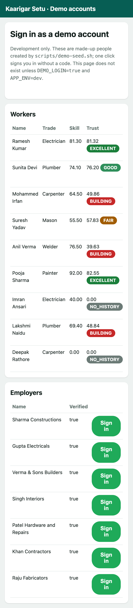
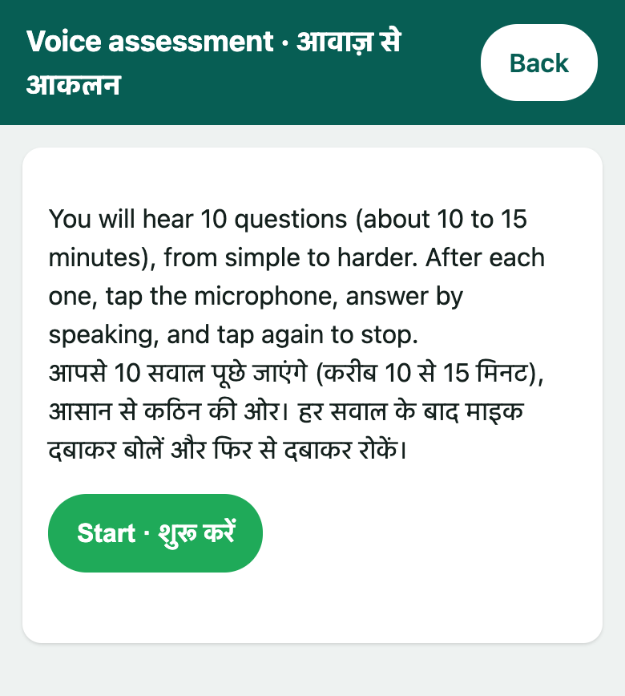
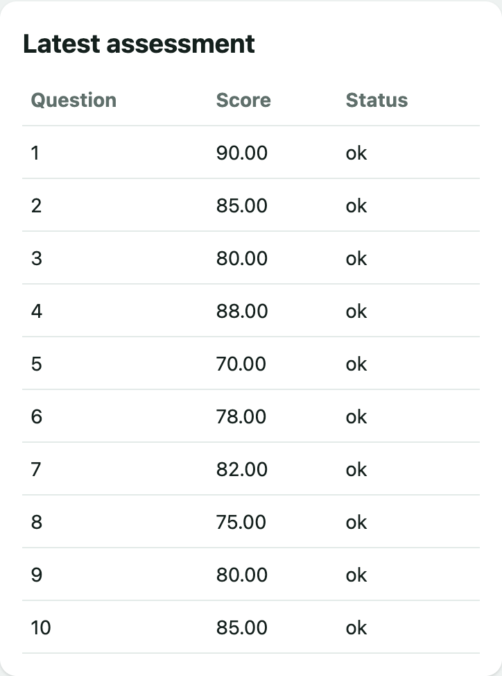
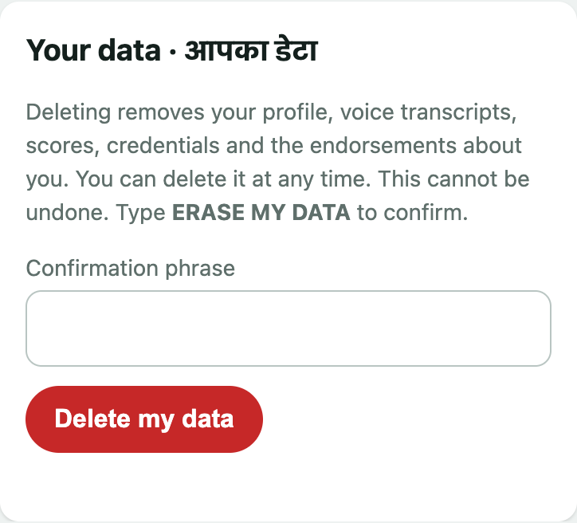
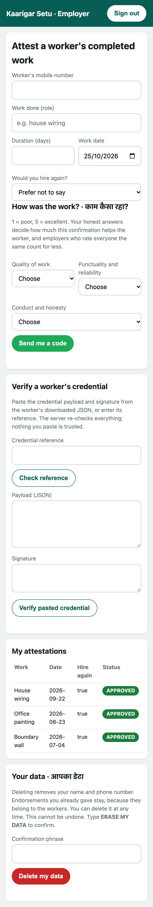
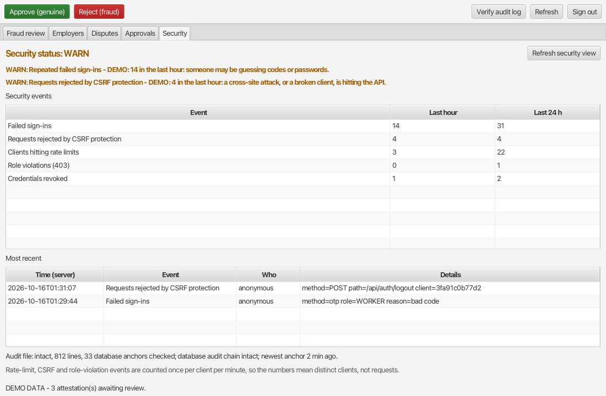

# Kaarigar Setu: project review guide (Java features and usability design)

This guide is for the project review. It explains **how the application works, step by step, with screenshots**, and divides the explaining between three team members.
It concentrates on the **Java features** the course covers (object-oriented design, exceptions, collections, file handling, JDBC, servlets, JSP, JavaFX, concurrency) and on
**usability design** (how a tradesperson actually uses it). The project is also an Information Security project; that part has its own documents (`docs/SECURITY_ARCHITECTURE.md`,
`docs/PENTEST_REPORT.md`) and is deliberately left out here.

> **Before you use this:** it proposes who explains what. Each person must understand their own part well enough to be questioned on it and must describe their own
> contribution truthfully. Change names and move items so the guide matches what really happened in your team.

| | **Member A: Structure** | **Member B: Usability and screens** | **Member C: Implementation (built with Claude Code)** |
|---|---|---|---|
| In one line | Decided how the code is organised and why | Decided how people use it and how the screens behave | Built the working application and the ML service, step by step, with Claude Code |
| Time in a 15-minute review | about 3 minutes | about 3 minutes | about 9 minutes |
| Explains | packages, object-oriented design, exceptions, collections, records | the three user journeys, bilingual voice-first screens, messages, the staff console | servlets, JDBC and transactions, file handling, concurrency, the ML service, the full flow through the code, testing, how Claude Code was used |

*If you have two members on structure: **A1** takes sections 1.1 to 1.3, **A2** takes 1.4 to 1.6.*

---

## 0. The project in one minute

**The problem.** A tradesperson (electrician, plumber, carpenter, mason, welder, painter) can be highly skilled and have nothing on paper. An employer cannot tell a skilled worker from someone who only claims to be.
Many workers read little and speak Hindi or another regional language.

**The idea: a Skill and Trust Passport in three steps.**

1. **Voice assessment:** the worker speaks answers to 10 questions about their trade; the server turns speech into text and scores each answer against a rubric.
2. **Employer confirmation:** employers who really hired the worker confirm the job and rate the work.
3. **Signed credential with a QR code:** the worker shows a credential that anyone can check, with no account.

**Three programs, one database:**

```
 Worker / employer / verifier (phone browser)       Moderator (desktop JavaFX console)
              │ HTTP                                        │ HTTP
              ▼                                             ▼
   ┌────────────────  Java web application (Tomcat, WAR) ──────────────────┐
   │  servlets  →  services (the rules)  →  DAOs (JDBC)                      │
   │  JSP pages + JavaScript for the browser                                 │
   └───────────────┬───────────────────────────────────┬───────────────────┘
                   ▼                                   ▼
            PostgreSQL 16                    Python ML service (FastAPI)
        (14 tables, numbered migrations)     speech to text · answer scoring · trust graph
```

Quote at the start: **144 Java source files in 17 packages, about 11,500 lines of Java, 498 Java tests passing** (plus 398 for the ML service and 18 for the console).

---

# Segment A: Structure (about 3 minutes)

**Your message:** "We organised the code so that each part has one job, new trades can be added with almost no change, and everything can be tested without a database or the internet."

## 1.1 Packages: one folder per responsibility

Source root: `kaarigarsetu-java/src/main/java/com/kaarigarsetu/` (17 packages).

| Package | Files | One job |
|---|---|---|
| `worker`, `employer` | 2 + 2 | registration, the worker's passport |
| `assessment` | 19 | the voice test: scoring rules per trade, the pipeline, skill bands |
| `attestation` | 8 | the employer-confirmation workflow |
| `trust` | 7 | the trust score and the endorsement graph |
| `credential` | 3 | issuing, verifying and revoking the signed credential |
| `moderator` | 3 | the staff queue and decisions |
| `dao` | 14 | all database access (one class per table, plus a shared base) |
| `model` | 18 | plain data carriers (all 18 are Java **records**) |
| `exception` | 15 | our own exceptions |
| `web` | 10 | `BaseServlet`, page servlets, filters, the wiring |
| `security`, `config`, `util`, `ml`, `privacy`, `admin` | 24, 5, 5, 2, 1, 5 | supporting parts |

The staff console is a **separate Maven module** (`kaarigarsetu-moderator-console/`), so staff tools are not shipped inside the public website.

**The layering rule to say out loud:** a servlet only handles HTTP; a service holds the rules; a DAO holds the SQL. A servlet never writes SQL and a DAO never knows about HTTP.

## 1.2 Object-oriented design

* **Abstract class and polymorphism: `AssessmentService`.** It states the rule that is the same for every trade: exactly 10 answers, scores kept between 0 and 100, the average is the result. Those methods are `final`, so no
  trade can change the rule. Each trade only supplies its name and its wording. Six subclasses extend it: `Electrician`, `Plumber`, `Carpenter`, `Mason`, `Welder`, `Painter`:

```java
public abstract class AssessmentService {
    public abstract String supportedTrade();
    public final AssessmentResult summarize(List<BigDecimal> perQuestionScores) { ... }   // same rule for every trade
    protected abstract String feedbackFor(BigDecimal score);                                // each trade words its own feedback
}
```

  `AssessmentScoringDispatcher` holds a `List<AssessmentService>` and picks the right subclass for a worker's trade: `dispatcher.resolve(trade).summarize(...)` runs the correct override at run time.
  *Adding a trade = one rubric file, one line in `trades.json`, one small subclass.*
* **Interfaces so parts can be replaced:** `OtpSender` (console sender for development, `HttpSmsOtpSender` for a real gateway), `MlGateway` (the real `MlServiceClient`, or a stand-in in tests), `ModeratorApi` (used by the console).
* **Dependency injection by constructor.** `web/AppContext` is the one place that builds everything: `new WorkerDao(pool, cipher)` → `new WorkerService(workerDao, ...)`. Classes receive what they need and never create it, so every service is unit-tested with mocks.
* **Records for data:** `Worker`, `Attestation`, `Credential`, `Edge`, `AssessmentResult`... immutable, no boilerplate.

## 1.3 Exceptions: one class per thing that can go wrong in the business

Fifteen classes in `exception/`, all unchecked (`extends RuntimeException`), for example `InvalidOTPException`, `DuplicateAttestationException`, `LowTrustScoreException`, `ConsentRequiredException`,
`UnintelligibleAudioException` (nothing could be heard), `ExternalServiceException` (ML service down), `ConflictException`, `NotFoundException`.

**One place turns them into answers:** `web/ApiErrors`. Whatever a service throws, the servlet's base class catches it there and sends the right HTTP status and a short code: wrong code → 401, duplicate → 409, missing consent → 403, ML down → 503.
The front end then maps each code to a friendly sentence (section 2.6). The service code stays free of `if (error) return ...` clutter.

## 1.4 Collections, generics and streams

* **Trust graph as an adjacency list:** `Map<String, List<Edge>>` built with `adjacencyList.computeIfAbsent(edge.source(), ignored -> new ArrayList<>()).add(edge)` in `TrustGraphService`.
* **Grouping feedback per worker:** `TrustScoreService` uses `Collectors.groupingBy(...)` into a `LinkedHashMap<Long, List<Feedback>>`, tracks workers in a `LinkedHashSet`, looks up employers in a `HashMap`.
* **Duplicate check with a stream:** `AttestationStore.add()` rejects a repeated worker-employer pair with `attestations.stream().anyMatch(...)`.
* **`Optional<T>`** is what every "find" returns (`workerDao.findById(id)`), so "not found" is handled explicitly.
* **Generics:** `Transactions.inTransaction(Supplier<T>)` returns whatever the work returns.

## 1.5 Data design

Fourteen tables (`workers`, `employers`, `assessments`, `attestations`, `trust_edges`, `credentials`, `fraud_flags`, `moderators`, `moderator_actions`, `trusted_devices`, `otp_challenges`, `audit_log`, and two tables of voice fingerprints used to spot repeated recordings),
created by `database/schema.sql` plus ten numbered migrations in `database/migrations/` so an existing database can be upgraded without losing data. Voice recordings are never stored; only the transcript and score are.

## 1.6 How a new trade is added (a good "extensibility" example)

1. Write the rubric questions and criteria for the trade (the ML service reads them). 2. Add one line to `trades.json` (English and Hindi name). 3. Add a ten-line subclass of `AssessmentService`. 4. Register it in `AppContext`. Nothing else changes.

## Segment A: questions to expect

| Question | Short answer |
|---|---|
| Why an abstract class and not an interface for scoring? | The scoring rule is shared code that must not be overridden; an abstract class can hold it, with `final` methods. Interfaces are used where parts are fully interchangeable (senders, gateways). |
| Why unchecked exceptions? | Business failures are handled in one place (`ApiErrors`); checked exceptions would force every method between to declare them. |
| Why plain JDBC and no framework? | The course teaches it, and it keeps every query visible and testable; a base class (`JdbcDaoSupport`) removes the repetition. |
| Why records? | Immutable data with equals, hashCode and toString for free; no accidental changes. |
| Where is the Python used? | Only for things Python is good at: speech models, scoring and the trust graph maths. Java owns the data and the rules. |

---

# Segment B: Usability and screens (about 3 minutes)

**Your message:** "A worker who reads little, on a basic phone, must finish a test by speaking, and an employer must confirm a job in under a minute. Every screen says in plain words what to do next."

## 2.1 Who uses it

| Person | Goal | Screens |
|---|---|---|
| **Worker** | get a passport that proves skill and reputation | sign-in, voice test, passport |
| **Employer** | confirm that a worker did a job, check a credential | employer dashboard |
| **Anyone** | check a credential from its QR code, no account | public check page |
| **Moderator** | review flagged items | desktop console |

## 2.2 The worker's journey, screen by screen

**Step 1. Sign in or register** (`index.jsp`). One page, two forms, bilingual labels ("Sign in · साइन इन", "Mobile number · मोबाइल नंबर"), a clear choice at the top: *I am a worker / employer*. The worker picks their trade and language when registering;
nothing is stored unless they tick consent.


*(For the demo we also have a development-only page that signs in as a made-up person with one click.)*



**Step 2. The passport starts empty and invites the next action.** A brand-new worker sees dashes and a large green button *Take the voice assessment · आवाज़ से आकलन शुरू करें*. Nothing is hidden and nothing is overwhelming.


**Step 3. The voice test starts** (`assessment.jsp`). One button, *Start · शुरू करें*. No typing anywhere.



**Step 4. Each question is shown and read aloud.** The page shows "Question 1 / 10" (progress), the question in the worker's language, and a large microphone button *Tap to answer · बोलने के लिए दबाएं*. The page also shows a short number to say at the end of the answer.
(The banner "TEST ONLY questions" is honest: the question set is a placeholder awaiting trade experts.)


**Step 5. Recording.** One big red stop button and a countdown ("Recording… 58s"). The worker is never asked to find a menu.


**Step 6. Feedback after every answer.** The page shows what it understood (the transcript), the score, short feedback (also spoken), then moves to the next question by itself. *In this screenshot the speech recogniser is the labelled test stand-in, so the transcript is a
placeholder and the score is 0; with the real Whisper model the transcript is what the worker said. The page also tells the worker, in plain words, that the practice scorer only checks which words were said.*


**Step 7. The passport fills in.** After 10 answers the worker sees the skill score, a band (Pass / Borderline / Needs review) and a **breakdown by area** (tools, materials, experience, knowledge, troubleshooting, planning, customer handling), each in English and Hindi.


**Step 8. The trust report explains itself.** Not just a number: how many employers confirmed, average quality, punctuality and conduct, would they hire again, and tips. The goal is that a worker understands *why* their score is what it is.




**Step 9. The credential.** A QR code, its status, a *Show live code* button, download and refresh buttons. The text beside it explains in one sentence what each is for.


**Step 10. The worker stays in control.** They see every confirmation an employer wrote about them and can **accept** or **dispute** it. At the bottom is a clearly separate "Your data" card for deleting everything.




## 2.3 The employer's journey

One page with three cards: *Attest a worker's completed work*, *Verify a worker's credential*, *My attestations*. The form asks only what is needed: the worker's mobile number, what work was done, how long, when, would you hire again, and three 1-to-5 ratings with the explanation
"Your honest answers decide how much this confirmation helps the worker." A code is sent to the *employer's* phone to confirm.


The same page on a phone:



## 2.4 The verifier's journey: the public check page

Anyone who scans the QR code lands on a page that answers three questions in order: *Is it valid?* (big green or red badge, one sentence), *Is the person showing it the owner?* (an amber note explaining the limit of a plain QR and suggesting the live code), *What does it say?* (a simple table).
It shows the worker's trade, scores and number of verified employers, but not their name or phone number.


## 2.5 The moderator's desktop console (JavaFX)

Five tabs: Fraud review, Employers, Disputes, Approvals, Overview. A table with the score, the evidence in plain language underneath, and two buttons: *Approve (genuine)* and *Reject (fraud)*. A status line at the bottom says what is waiting.
(These three screenshots were taken earlier from the same console; the first one is from before the Disputes and Approvals tabs were added.)




## 2.6 Usability design decisions (the list to speak from)

| Decision | How it shows | Where in the code |
|---|---|---|
| **Voice first, no typing** | questions are spoken, answers are spoken | `assessment.js` (`speak`, `record`) |
| **Two languages on every label** | "Sign in · साइन इन" | all JSP pages; `PageServlets` label maps |
| **One thing on the screen at a time** | a single big button for the next action | the `dock` area in `assessment.js` |
| **Always show progress** | "Question 3 / 10", "Recording… 41s" | `assessment.js` |
| **Friendly messages for every failure** | a table of error codes to plain sentences, in both languages where it matters | `MESSAGES` and `errorText()` in `common.js` |
| **Works with any phone microphone** | any recording format is converted in the browser to the one format the server accepts | `wav.js` |
| **Fast second visit** | a returning browser is recognised, so no extra steps | `auth.js` |
| **Explain the number** | trust report with tips; credential screen with a sentence per button | `worker-dashboard.jsp`, `worker.js` |
| **Honest labels** | "TEST ONLY questions", "Practice scoring", "Static link" notices | `assessment.js`, `verify.jsp` |
| **User control** | accept or dispute a confirmation; delete my data | `worker.js`, `common.js` |
| **Phone-sized by default** | single column, large tap targets, one small stylesheet (`app.css`) | `app.css` |
| **Responsive staff tool** | the console never freezes while it waits for the server | JavaFX `Task` and `Platform.runLater` |

## Segment B: be ready to say what is *not* done

No automated browser tests; not yet tried by tradespeople on their own phones; no notifications to the worker; only Hindi and English; the question set is a placeholder awaiting trade experts.

## Segment B: questions to expect

| Question | Short answer |
|---|---|
| Why voice and not a typed quiz? | Many tradespeople read little; speaking is natural to them. |
| How do you cope with different phones? | The browser records whatever it can, and `wav.js` converts it to 16 kHz mono WAV before sending. |
| What if the microphone is refused? | The page says so in plain words in both languages and offers *Try again*. |
| How did you decide what to put on the passport? | What an employer would ask first: how skilled, how reliable, who says so; then explain each number. |
| What would you add? | Notifications, more languages, a real expert-written question set, tests with real workers. |

---

# Segment C: Implementation, built with Claude Code (about 9 minutes)

**Your message:** "I built the working application with Claude Code. I decided what to build next, read what it produced, ran the tests and the live system, and fixed what failed. Here is how one request travels through the code."

## 3.1 How the work was done with Claude Code (say this first)

* **What I did:** chose each feature and its requirements, asked for the reasoning to be explained, ran the tests and the real application, and sent back anything that failed.
* **What Claude Code did:** wrote the code, tests and scripts for each feature and ran builds and test suites.
* **The rule:** a feature is not "done" until it passes its tests *and* works in the running system. This found real mistakes in both the code and our own tests (section 3.8), which is the evidence it was checked and not just generated.

## 3.2 What was built

| Part | Where | Size |
|---|---|---|
| Web application | `kaarigarsetu-java/src/main/java` | about 11,500 lines, 144 files |
| Pages and scripts | `webapp/WEB-INF/jsp` (7), `webapp/static/js` (8), `static/css/app.css` | about 1,100 lines |
| ML service | `kaarigarsetu-ml-service/app` | about 1,500 lines of Python |
| Moderator console | `kaarigarsetu-moderator-console` | about 1,400 lines of JavaFX |
| Database | `database/` | schema + 10 migrations |
| Scripts | `scripts/` | about 3,500 lines (setup, end-to-end test, API test, demo data) |
| Tests | `src/test`, `tests/` | about 9,800 lines, 914 tests in all |

## 3.3 Step by step: one request through the layers (the key explanation)

Follow **"the worker taps record, speaks, and sees a score"** from the screen to the database and back. Each step names the file.

**1. The browser records and converts** (`assessment.js` → `wav.js`). `MediaRecorder` captures audio; `wav.js` decodes it, mixes to mono, resamples to 16 kHz and writes a 16-bit WAV (about 1.9 MB for 60 seconds).

**2. The page uploads it** (`common.js` → `KS.api`). One shared helper adds the headers and returns `{ok, status, data}`, so every screen handles results the same way:

```js
KS.api('POST', '/api/assessment/submit-answer?attempt=' + attempt + '&question=' + id, wavBlob)
```

**3. The servlet receives it** (`assessment/AssessmentServlet`, extends `web/BaseServlet`). It reads the bytes, finds the signed-in worker, and calls one service method. `BaseServlet.service()` wraps everything in a `try/catch`; any exception goes to `ApiErrors`.

**4. The service runs the rules** (`assessment/AssessmentPipelineService.submitAnswer`). In order:

1. check the answer is the next one in sequence and that the WAV is well-formed (`util/WavValidator` reads the header from the byte stream);
2. send the audio to the ML service for transcription (`ml/MlServiceClient`, `java.net.http.HttpClient`, multipart upload);
3. ask the ML service to score the transcript against the trade's rubric;
4. overwrite the audio in memory (`Arrays.fill(audio, 0)`): recordings are never kept;
5. save the answer, in a **transaction** (below);
6. after the 10th answer, call the trade's `AssessmentService.summarize(...)` (polymorphism) and build the skill band and per-area breakdown (`SkillScoring`, records `SkillProfile`, `Band`).

**5. The DAO writes it** (`dao/AssessmentDao`, extends `JdbcDaoSupport`). A `PreparedStatement` with `?` placeholders in a try-with-resources block, so the connection always closes; a failure becomes our own `DataAccessException`:

```java
try (var connection = connectionProvider.getConnection();
     PreparedStatement statement = connection.prepareStatement(sql)) {
    statement.setLong(1, workerId);
    ...
} catch (SQLException exception) { throw dataAccessException("find worker", exception); }
```

**6. Several writes happen together or not at all** (`config/PooledConnectionProvider`). `inTransaction(work)` binds one connection to the current thread (`ThreadLocal<Connection>`); every DAO that asks the pool for a connection gets that same one, and the pool commits at the end or rolls back on an exception. Services never touch `commit()`.

**7. The answer goes back** as JSON (`BaseServlet.json(...)`, Gson) and the page shows the transcript, the score and the feedback, speaks the feedback, then asks the next question.

## 3.4 More walk-throughs (pick what is asked)

**Register and sign in.** `index.jsp` + `auth.js` → `AuthServlet` (`/api/auth/*`) → `WorkerService.register` (checks consent, trade, language; normalises the phone; one transaction: "already registered?" then insert; writes an audit line) → `WorkerDao`. Sign-in sends a six-digit code through the `OtpSender` interface (console in development, SMS gateway when configured) and starts a session.

**The passport page.** `PageServlets.WorkerDashboard` loads `WorkerService.passport(workerId)` (a record with scores, bands, trust report, credential reference), puts it in the request and forwards to `worker-dashboard.jsp`, which prints it with JSTL (`<c:out>`, `<c:if>`, `<c:forEach>`). The page script (`worker.js`) then loads the confirmations and the credential with `KS.api`.
The label maps (skill areas, bands) in both languages are in `PageServlets`.

**The employer confirms work.** `employer.js` → `AttestationServlet` → `AttestationWorkflowService`: validates the request, stores a pending confirmation, sends a code to the employer's phone; the employer enters it; the service marks it approved, adds an `Edge` to the trust graph, recomputes the worker's trust (`TrustScoreService`, grouping feedback with `groupingBy`, weighting each employer), and re-issues the credential. A duplicate pair raises `DuplicateAttestationException` (shown as "already confirmed by you").

**The credential.** `CredentialService.issue` builds the credential document, signs it with the application's private key, saves it, writes a JSON copy to disk (`util/CredentialExporter`, `java.nio.file`) and returns a QR code image. `GET /api/credential/{ref}/verify` is public, `verify.jsp` shows the result.

**The moderator console.** A separate JavaFX application: `ModeratorConsoleApp` builds the `TabPane` of `TableView`s; `HttpModeratorApi` (behind the `ModeratorApi` interface) calls the same Java API over HTTP; every network call runs in a `javafx.concurrent.Task` and updates the table in `Platform.runLater`, so the window stays responsive.

**The ML service** (Python, FastAPI, `kaarigarsetu-ml-service/app`): routes `transcribe` (Whisper speech to text), `evaluate` (rubric scoring), `trust` (PageRank over the endorsement graph), `fraud` (an Isolation Forest that flags unusual bursts of confirmations for a moderator). The Java side talks to it only through the `MlGateway` interface; if it is down the application answers "service unavailable" and keeps working.

## 3.5 Java features, mapped to where they are used (one table to point at)

| Course topic | Where |
|---|---|
| Packages and layering | 17 packages; servlet → service → DAO |
| Abstract class, inheritance, polymorphism | `AssessmentService` and six trade subclasses; `AssessmentScoringDispatcher` |
| Interfaces and dependency injection | `OtpSender`, `MlGateway`, `ModeratorApi`; `AppContext` wires by constructor |
| Records (Java 17) | all 18 model classes and 56 files overall |
| User-defined exceptions | 15 classes; `ApiErrors` maps them to HTTP |
| Collections, generics, streams, `Optional` | `TrustGraphService`, `TrustScoreService`, `AttestationStore`, every DAO `find` |
| File handling (`java.io`, `java.nio.file`) | `AuditLogWriter` (append-only file), `CredentialExporter` (JSON copy), `WavValidator` (reads a byte stream) |
| JDBC with `PreparedStatement` | 13 DAO classes on `JdbcDaoSupport`; `PooledConnectionProvider` (pool and transactions) |
| Servlets and filters | 14 servlets with `@WebServlet`; 3 filters; `BaseServlet` |
| JSP with JSTL | 7 pages; JSTL tags for display |
| JavaFX | the moderator console: `TabPane`, `TableView`, `Alert`, `Task` |
| Concurrency | `synchronized` stores, `ConcurrentHashMap`, a `ReentrantLock` on the audit file, `ThreadLocal` transactions, JavaFX `Task` |
| Date and time | `java.time` with an injected `Clock`, so time-dependent code can be tested |
| Networking | `java.net.http.HttpClient` for the ML service and the SMS gateway |

## 3.6 How it is tested

| Level | What | Result |
|---|---|---|
| Unit tests (JUnit 5 and Mockito) | each service with mocked DAOs and gateways | 498 Java tests in all |
| Database tests | the DAOs against real PostgreSQL: constraints, transactions, simultaneous requests | included above |
| ML service tests (pytest) | every route and the scorers | 398 |
| Console tests | JavaFX logic | 18 |
| End-to-end run | the real running application, all journeys, with a labelled test stand-in for the speech model | 192 checks |
| API check | every endpoint and its expected status | 92 checks |

## 3.7 Live demo for this segment (about 3 minutes)

1. Open the passport of a demo worker and point at each card (the screenshots above, live).
2. Run the first question of the voice test: question shown, number shown, record, feedback.
3. In the employer dashboard confirm a job for a worker, then reload the worker's passport: the trust report changes.
4. Open the public check page for the credential.
5. Show the end-to-end run's output: 192 checks passing.

## 3.8 Mistakes the testing found (good to tell: it shows the work was checked)

* **A limit that could be beaten by simultaneous requests:** a worker may have three open disputes, but six requests at once let four through. Fixed by locking the worker's row for the duration; a test that fails three times out of three without the fix.
* **Our own tests passed for the wrong reason:** a missing token made every request fail with "forbidden", which looked like a blocked attack. Every attack test now needs a control that must succeed.
* **A missing script:** a copy step silently skipped the audio converter, so every recording failed on one build. A test now fails the build if any page references a missing script.
* **A canned test sentence was flagged by the application's own checks:** shortened, with a test so it cannot return.

## 3.9 What is still open (say it before they ask)

1. Questions are placeholders; real trade experts have not yet written or validated them.
2. Real accuracy on tradespeople's actual speech is not measured (word error on real speakers is about a third).
3. A flagged answer has no staff review screen yet; the worker retakes.
4. Docker, the HTTPS proxy, the GitHub pipeline and a real SMS gateway were written but not run on real infrastructure.
5. No notifications, only two languages.

## Segment C: questions to expect

| Question | Short answer |
|---|---|
| How much did you write yourself and how much did Claude Code write? | Be specific and truthful: most code was generated by Claude Code from requirements you gave; you reviewed it, ran it and can explain it. Offer to open any file. |
| How do you know the code is correct? | Tests at every level, a real end-to-end run, and the list of mistakes they found (3.8). |
| Why PreparedStatement? | Parameters are sent separately from the SQL text, so input can never change a query; a test fails the build if SQL is ever built from strings. |
| What is a transaction here? | Several database writes that must succeed or fail together; `inTransaction` shares one connection per thread and commits or rolls back. |
| How does a servlet differ from a JSP here? | A servlet handles the request and decides; a JSP only formats data it is given. Pages are only reachable through their servlet. |
| Why a separate Python service? | Speech and scoring libraries are in Python; Java calls it over HTTP through one interface and still works if it is down. |
| What is polymorphism in your code? | The dispatcher holds a `List<AssessmentService>`; calling `summarize` on the chosen one runs that trade's override. |

---

# Putting it together

## Suggested 15-minute running order

| Minutes | Who | What |
|---|---|---|
| 0:00 to 1:00 | A | The problem, the idea, the three programs (section 0) |
| 1:00 to 4:00 | A | Packages, object-oriented design, exceptions, collections (segment A) |
| 4:00 to 7:00 | B | The worker, employer, verifier journeys with the screens (segment B) |
| 7:00 to 14:00 | C | How it was built with Claude Code, the request walk-through, the demo, tests (segment C) |
| 14:00 to 15:00 | C then A | What is still open; one-sentence close |

## Hand-over sentences

* A to B: "That is how the code is organised. [B] will show what a worker experiences on top of it."
* B to C: "Every screen you saw is backed by the server. [C] built it and will trace one request from tap to database."
* C to A: "[A] will close with what we would do next."

## Everyone should be able to answer

1. What is the product, in one sentence? 2. What are the three programs and which one holds the data? 3. Name three Java features used and one file for each. 4. What does a worker do, step by step, to get a passport? 5. What is still not done?

## Where to find more

| Topic | Document |
|---|---|
| Java features with file and line references | `README_JAVA_FEATURES.md` |
| Overview and how to run | `README.md`, `docs/PROJECT_OVERVIEW.md` |
| Trust score and bands | `docs/TRUST_SCORE.md` |
| API | `docs/API_REFERENCE.md` |
| Demo accounts and order | `docs/DEMO_DATA.md`, `docs/DEMO_SCRIPT.md` |
| Test results | `docs/TEST_REPORT.md` |
| Security (separate topic) | `docs/SECURITY_ARCHITECTURE.md`, `docs/PENTEST_REPORT.md`, `docs/REPLAY_DETECTION.md` |

*Screenshots in this guide are in `docs/review-screenshots/` and were captured from the running application on a phone-sized window (the console images are the desktop window).*
